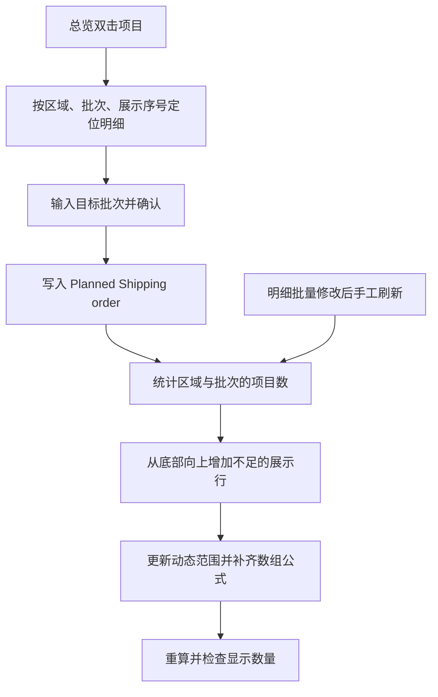

# Excel 出货计划自动化

> **流程说明更新至 V13（2026-09-29）**：请先阅读[完整项目流程](docs/PROJECT_REPORT.md)与[当前状态](docs/CURRENT_STATUS.md)。V13 指本地专用工作簿的功能阶段，**不代表仓库源码已同步至 V13**。

基于 Excel VBA 的出货计划维护工具：在总览表双击项目修改批次，反写明细表，并按各区域的项目数量自动扩展总览展示行。

> 本次更新仅发布脱敏 Markdown 文档，不上传工作簿、来源文件、内部快照或业务数据。此声明不构成对仓库历史附件的脱敏认证。早期源码中的明细工作表名称已统一为 `Shipping planning`。

## V13 完整流程入口

备份 `.xlsm` → 准备本项目明细 → 在 Shipping Program 维护项目信息和参数 → 导入 Plant 与静态快照 → 在 planning 单独更新安装日期 → 检查异常 → 更新计划与总表 → 核对最终批次和日期 → 必要时双击调批或新增补充船次 → 保存。

导入不追加任务，也不直接更新安装日期；Automatic 是建议，Planned 才是最终安排。参数修改后需点击更新按钮；人工固定批次不被覆盖，但对应日期可能变化。详细按钮、公式、错误处理、新项目迁移和安全边界见[完整项目流程](docs/PROJECT_REPORT.md)。

## 项目背景

原工作簿由明细表驱动总览表。用户可以在明细中修改发运批次，但无法从总览直接调整。总览每个区域的展示行数固定，当某批次的项目超过容量时，数据仍在明细中，却不会全部显示。

本项目保留 Excel 的使用方式，把总览从单纯的展示页扩展为发运批次调整入口。

## 早期仓库源码能力（不是 V13 功能清单）

| 功能 | 实现方式 |
|---|---|
| 总览双击调整批次 | 工作表双击事件调用 VBA，输入并确认目标批次 |
| 保留自动建议值 | 仅覆盖 `Planned Shipping order`，不修改 `Automatic Shipping order` |
| 自动扩行 | 按区域内项目最多的批次计算容量，从下往上插入不足的行 |
| 保留区域排版 | 复制新增行格式、行高，补齐区域名称及所有批次的数组公式 |
| 动态明细范围 | 刷新时根据实际最后一行更新隐藏名称，突破原第 1000 行限制 |
| 同名项目定位 | 依据区域、批次、当前展示序号定位明细，不单独依赖名称 |
| 手工刷新 | 明细批量修改后运行 `RefreshShippingSummary` |
| 输入及结果检查 | 检查批次、区域、手工内容、公式类型和显示数量，失败时明确报错 |

## 早期仓库源码数据流

## 安装与文档

- [完整项目流程与 V13 功能边界](docs/PROJECT_REPORT.md)
- [当前状态与版本阅读入口](docs/CURRENT_STATUS.md)
- [早期源码安装及使用指南](docs/INSTALLATION.md)
- [早期验证记录与已知限制](docs/VALIDATION.md)
- `src/ShippingTools.bas`：普通 VBA 模块。
- `src/SummarySheetEvent.txt`：总览工作表的事件代码。

运行环境：Windows 桌面版 Excel，启用 VBA；文件保存为 `.xlsm`。网页版 Excel 不运行 VBA。其他平台尚未验证。

本项目不是适用于任意 Excel 文件的通用插件。部署前必须核对工作表布局，在副本中验证，并遵守组织的宏安全策略。
