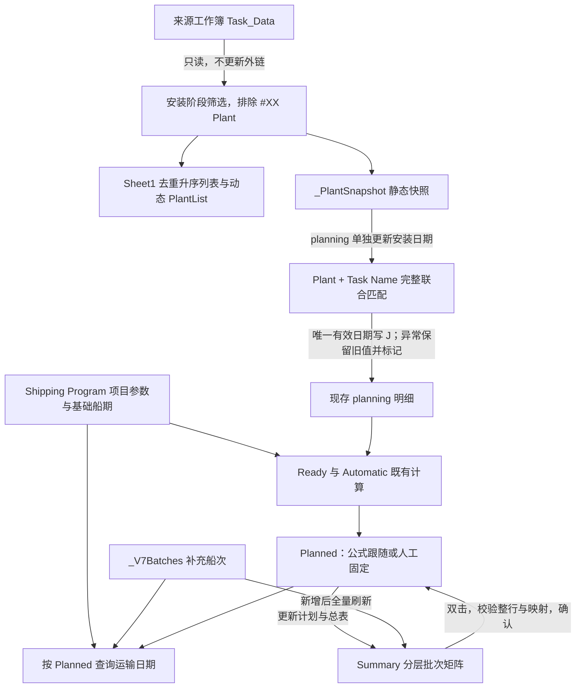

# Excel 出货计划自动化：完整项目流程（至 V13）

> 更新日期：2026-09-29。本文依据本地交付过程的功能摘要，描述专用 Windows 桌面 Excel 工作簿至 V13 的使用流程与边界。**仓库 `src` 为早期脱敏源码，不等同于 V13 完整实现**；本文不是对仓库源码或附件的最新版本认证，也不是可直接部署 V13 的源码包。
>
> 本次仅发布脱敏 Markdown 文档，不上传工作簿、来源文件、客户信息、真实任务、内部快照、代码提取或本地路径。下文只使用通用字段和匿名规则示例；历史报告中的业务统计不再作为演示内容。

## 1. 项目目标、交付与角色

项目在既有 Excel 出货计划上增量自动化，减少安装日期查找、批次安排和总览维护中的重复操作。它保留明细中的人工决策，不是全量来源任务同步器，也不是完整物流管理系统。

交付形式是专用 `.xlsm`，不是可用于任意工作簿的 `.xlam` 加载项。使用 Windows 桌面 Excel 并遵守组织宏安全策略；网页版 Excel 不运行 VBA，Mac、WPS 无兼容性保证。仅修改文件后缀不能转换为通用插件。

| 角色 | 责任 |
|---|---|
| 来源计划维护者 | 提供正确项目的 Task_Data，核对任务名称、Plant、阶段和开始日期 |
| 出货计划维护者 | 维护本项目出货明细、参数、安装日期异常与最终 Planned 批次 |
| 复核者 | 核对人工固定批次的实际日期、缺失分类及异常；确认后保存 |

角色可由同一人承担。建议指定一个主文件及维护责任人；各副本不会自动同步，没有多人并发冲突控制。

## 2. 工作表与数据职责

| 工作表 / 名称 | V13 职责与状态 |
|---|---|
| Shipping Program | 唯一项目信息和参数入口；上方信息与参数，下方基础船期；灰白一致 UI，不冻结窗格；“导入 Plant”“更新计划与总表”按钮置右 |
| Project Basic | 已合并至 Shipping Program 并删除，不再作为第二套项目参数入口 |
| planning | 现存出货明细及人工字段；F 列 Plant 下拉，I 列 Ready，J 列安装日期，O 列 Automatic，P 列 Planned |
| Summary | Product → Plant → Task 分层总览，横向按最终 Planned 批次展示；保留顶部及左两列冻结 |
| Sheet1 | Hidden；保存完整去重、升序 Plant 列表，不是面向用户的主操作页 |
| PlantList | 工作簿级命名范围，引用 `Sheet1!A2:A最后行`；成功导入后按数量增减，作为 planning F 列验证来源 |
| Information | 已删除；Summary 底部原 Information Product/Plant 列表验证已取消，其他正常验证保留 |
| _PlantSnapshot | VeryHidden；保存日期匹配所需来源记录、来源名、导入时间及 READY 状态 |
| _V7Batches | 保存补充船次配置 |
| _V7Map / _V7Snapshot | 总览位置到明细行的映射及变更校验，不是永久业务 ID |
| _ImportUI | 导入界面文案 |

内部名称中的 `V7` 是历史命名，不表示当前功能仍停留在 V7。Hidden 和 VeryHidden 都不是脱敏、加密或访问控制措施。

### 项目级输入

Shipping Program 统一维护 `Project name`、`Project No`、`Country`、`Customer Address`，以及订舱周期、海运时长、ETS−ETA 间隔、发船间隔和首班 ETD。一工作簿只对应一个项目，所有基础批次共用这组参数。

当前统一使用 NR Booking Period，不区分 BB、FR，不新增任务类型。不根据 Country 自动推导海运时长。ETS 仅按 ETA 加间隔计算；是否代表到现场，须由业务确认，不能自行赋予该含义。

## 3. 架构与输入输出



| 操作 | 输入 | 输出 | 不执行的动作 |
|---|---|---|---|
| 导入 Plant | 用户选择含 Task_Data 的 `.xlsx` / `.xlsm` 来源 | Plant 清单、PlantList、内部快照、导入状态 | 不写 J，不追加任务，不保存来源 |
| 更新安装日期 | 最近一次成功导入的快照、现存明细联合键 | J 日期更新、异常标记与分项统计 | 不重新读取来源，不覆盖人工业务字段 |
| 更新计划与总表 | 当前参数、明细和批次配置 | 统一重算计划并刷新 Summary | 不重新导入，不重新匹配安装日期 |
| 总览双击调批 | 已验证任务对应行、目标批次、用户确认 | 写该行 P，局部更新受影响 Plant | 不修改 O，不按名称猜测任意同名行 |
| 新增船次 | 基础批次、补充 ETD | 补充编号、日期和配置，全量刷新 | 不改变基础编号，不纳入 Automatic 推荐 |

来源读取完成后是静态快照，不保留持续外部连接。来源以后变化，必须重新导入；“导入成功”不代表日期已更新或计划已核实。

## 4. 导入与安装日期更新

### 4.1 导入 Plant

在 Shipping Program 点击“导入 Plant”，通过文件选择器选择当前项目来源。来源以只读方式打开，不更新外部链接，不保存来源文件。

筛选与提取规则：

- 工作表为 `Task_Data`，使用 `Plant`、`Task_Name`、`Start_Date`、`Project_Step_Phase` 字段。
- 仅保留 `Project_Step_Phase = '5 - Installation'`，排除 Plant 以 `#XX` 开头的记录。
- 匹配记录保存为内部快照；Plant 去重升序写入 Sheet1。
- 每次成功导入按列表长度重建 PlantList 的引用范围，允许增长和缩短；旧明细中的 Plant 不因来源删除而被清空。
- 主界面显示所选文件名、导入时间、Plant 数量、快照数量，便于在本地确认来源；这些状态内容不得作为公开文档截图或附件上传。

失败时尝试回滚并保留原 Plant 清单与范围。持续故障导致无法完整恢复时须明确报错，不能宣传所有失败都具有百分之百原子性。看到失败提示后应检查旧清单、范围及状态，必要时从备份恢复，不继续假定新来源已生效。

### 4.2 单独更新安装日期

在 planning 点击“更新安装日期”，从最近的快照按 **Plant + Task Name 完整联合键**匹配；忽略大小写及首尾空格，不模糊匹配、不做子串匹配。没有可用快照时提示先导入。

| 匹配结果 | 对 J 列的处理 | 复核要求 |
|---|---|---|
| 唯一候选且日期有效 | 写入纯日期，去掉时分秒，显示 `yyyy/mm/dd` | 确认对应的是所需安装任务 |
| 唯一有效日期与原值相同 | 保留一致日期，清除旧异常标记 | “未变”不是未运行 |
| 未匹配、多候选、日期无效 | 保留旧值，红底深红字，并以批注说明原因 | 原日期未核实，不能忽略标记 |

标记使用专用异常内容，不应破坏原有业务备注。来源日期仅支持数值日期及已支持的文本格式，不能承诺解析任意文本日期。

此操作不自动追加来源任务，不覆盖供应商、箱量、备注或人工 Planned，也不会把 `none` 自动改成另一个业务值。来源删除不会自动删除明细。数量、子项范围或附加描述差异不能直接视为拼写错误；改名必须先人工确认业务含义。

**异常保留的旧日期仍可能参与后续计算。** 总览正常、有推荐批次或日期未变，都不等于安装日期已经核实。

## 5. 计算规则与人工控制边界

以下为现有业务规则的说明，不是本次改写公式或新增算法。

| 项目 | 规则 |
|---|---|
| 基础船期 | 预设批次 1–36；首班 ETD 手工输入，后续 ETD = 前班 ETD + 发船间隔 |
| ETA | ETD + shipping period |
| ETS | ETA + ETS−ETA 间隔 |
| Ready（I） | J −（booking period + shipping period + ETS−ETA 间隔）；是倒推计划节点，不是实际备货完成日 |
| Automatic（O） | 近似 VLOOKUP 查找 ETD 不晚于 Ready 的最近基础批，再将批次号减 1，即再提前一批；保留既有规则 |
| Planned（P） | 最终批次；可为同一行引用 O 的公式，也可为人工固定数字或补充船次文本 |
| 明细 ETD / ETA | 按 P 查 Shipping Program；补充船次回退查 `_V7Batches` |
| 提货日期 | ETD − 7，沿用既有规则 |

近似查找依赖基础船期的正确日期及顺序。Ready 早于首批可能出现 `#N/A`，减 1 后可能得到 0 等显式异常；不能承诺任何日期都能推荐有效批次。预设 1–36 也不意味着会无限延长船期。

参数修改后显示待更新状态，需要点击“更新计划与总表”统一重算和刷新，**不是每填写一个值就自动重建总览**。该按钮不会代替导入或更新安装日期。

公式型 P 会跟随 O 的变化；人工固定 P 不被参数更新覆盖，但该批次号对应的 ETD、ETA 等日期仍可能变化。固定批次不等于冻结日期。要恢复自动跟随，应在确认意图后恢复 P 对同一行 O 的公式引用。

## 6. Summary 展示与双击调批

Summary 纵向为 Product → Plant → Task，横向为最终 Planned 批次。只展示现存明细中有任务的 Plant，导入 Plant 列表本身不会自动生成任务区。

同一 Plant 的容量按其各批次任务数最大值动态确定，任务按明细行顺序排列。保持 V6 分类底色、网格、居中和换行，分类之间保留白色间隔；顶部和左两列冻结不变，与不冻结的 Shipping Program 区分。

| 情况 | 展示及处理 |
|---|---|
| 缺 Product | 标为 `[MISSING Product]`，需要人工补分类 |
| 无效、未知或错误 Planned | 进入 `DATA ERRORS`，修复后刷新 |
| Task 为空的业务行 | 可能跳过，需人工核对，不能只靠总览统计判断完整性 |
| 批次正常但其他日期列有错误 | 仍可能正常归入批次；DATA ERRORS 不是所有列的通用错误检测 |

双击任务后先校验对应明细整行、位置映射及变更快照，再要求确认；通过后只写该行 P，并局部更新受影响的 Plant。容量不足时扩行，局部移动后不立即缩掉空行。

同名任务不能单靠名称定位。工作簿内容变化后，安全校验可能保守地要求先刷新，应按提示操作，不取消校验。直接编辑 planning 的 P 后也要刷新 Summary，这不是即时双向同步。

## 7. 补充船次

通过新增船次功能选择基础批次，系统分配下一个后缀，例如 `1-1`、`1-2`；编号保存为文本，避免被 Excel 当作日期。输入 ETD 后按既有规则生成提货日期、ETA、ETS：

```text
提货 = ETD - 7
ETA  = ETD + shipping period
ETS  = ETA + ETS-ETA 间隔
```

基础编号不变，补充船次只供人工选择，不进入 Automatic 的基础查找推荐。新增操作走全量刷新，配置随工作簿保存保留，重开后继续使用。

删除展示列不等于删除配置。目前没有完整的用户安全删船流程，不能擅自删除仍被明细引用的配置。

## 8. 日常操作与新项目迁移

### 推荐日常顺序

1. 先将工作簿另存备份，保持 `.xlsm`；确认可信宏环境。
2. 确认是同一项目的更新；若用于新项目，先准备该项目自己的出货明细。
3. 在 Shipping Program 输入或核对项目信息、统一参数和首班 ETD。
4. 点击“导入 Plant”，选择正确来源，检查界面状态、时间和数量。
5. 在 planning 单独点击“更新安装日期”，查看实际变更、未变及异常统计。
6. 检查红色标记和批注，对未匹配、多候选、无效日期逐项复核。
7. 点击“更新计划与总表”，完成重算和总览刷新。
8. 检查 DATA ERRORS、缺 Product、可能跳过的空 Task 行，以及人工固定批次对应的实际日期。
9. 必要时双击调批或新增补充船次；如直接改 P，再刷新 Summary。
10. 确认明细、总览和日期一致后保存 `.xlsm`。

### 新项目复用不是只改项目名称

已有工作簿不是已清理的空白多项目模板。复用时须在独立副本中准备新项目明细，并核对分类、人工字段、P 中的固定安排、基础船期和补充船次配置。不能只修改项目名称就继续使用旧项目任务。

重新导入只能替换清单和快照，不会替换旧明细，也不会自动清理旧任务或安排。需要清理旧项目内容时由维护者逐项确认；不要直接删除内部表或仍被引用的船次配置。新项目完成全流程验收后才作为主文件使用。

## 9. 常见问题与错误处理

| 现象 | 原因 / 下一步 |
|---|---|
| 导入成功，J 没变 | 导入和更新日期是分离操作；到 planning 单独更新 |
| 来源改了，计划仍旧 | 静态快照不持续连接；重新导入，再更新安装日期，最后更新计划与总表 |
| 新来源 Plant 减少，旧明细仍在 | 预期保留行为；来源不是明细删除指令，人工确认是否需要调整 |
| 下拉没有新 Plant | 检查导入是否成功、PlantList 是否对应 Sheet1 新范围；失败后不要假定新范围已提交 |
| 日期红标但仍有批次 | 异常旧值被保留且可能继续参与计算；核对来源，不把推荐当成核实 |
| 名称看似相同却未匹配 | 检查 Plant、完整任务名称及候选数量；不要以模糊匹配掩盖子项范围差异 |
| Automatic 为 `#N/A` 或 0 | 检查 Ready、首批及基础船期；既有规则不能保证所有输入可推荐 |
| 参数改了，人工 P 没变 | 固定 P 保留是预期；点击更新并核对其对应日期是否变化 |
| 直接改 P 后总览没同步 | 刷新 Summary；直接编辑不是即时双向更新 |
| 双击要求刷新 | 整行或映射变更可能导致定位过期；刷新后再操作，不绕过安全检查 |
| DATA ERRORS 为空，仍有错误日期 | 该区域不检查所有列；继续检查日期、红标与空 Task 行 |
| 日期显示 `###` | 检查列宽、日期值和格式；不能据此认定数据丢失或仅有显示问题 |
| 导入失败或恢复失败 | 阅读明确错误提示，核对旧清单与范围；无法确认一致性时恢复备份 |
| 删除总览船次列后又出现 | 配置仍保存在内部表；没有完整安全删除流程，不擅自删配置 |
| Ctrl+Z 无法恢复 | VBA 通常不能依赖原生撤销；没有主动撤销历史，使用预先保存的备份 |

## 10. 验证事实与验收边界

根据本地交付记录，主要功能已在独立测试副本中验证。本次工作仅整理并上传文档，未重新打开生产工作簿或复跑 VBA，以下不构成仓库 CI 结果。

| 验证范围 | 已记录事实 |
|---|---|
| 导入职责分离 | 导入生成列表与快照，不直接写安装日期；单独更新才写 J |
| V13 动态列表 | 测试列表增长、缩短及去重后，PlantList 引用随之更新 |
| 导入失败恢复 | 已验证失败回滚场景；不外推为持续故障下全部操作都能完整恢复 |
| 明细保留 | 来源列表缩短不清空旧明细 Plant，保存重开后仍保留 |
| 保存与刷新 | 已验证保存重开及 Summary 刷新，主要配置和快照流程可继续使用 |
| 日期与人工安排 | 已验证主要精确匹配流程及人工安排保留；异常仍须业务复核 |
| 总览与补充批次 | 已验证主要定位、调批、补充船次与格式保持流程 |

没有自动点击文件选择原生弹窗和双击后的原生确认 UI；核心流程测试不等于所有 UI 弹窗端到端自动化测试。不引用旧版本性能秒数作为 V13 保证，也未宣称量化工时收益或覆盖任意环境。

部署或新项目验收建议：在匿名测试副本中完成列表增长与缩短、重复 Plant、无快照、无效日期、多候选、失败恢复、人工固定 P、过早 Ready、同名任务定位、补充船次及保存重开；分别核对明细、映射、总览、日期和提示。测试数量仅为测试输入，不应使用真实业务统计作为公开示例。

## 11. 版本沿革与未实现内容

| 阶段 | 演变及保留边界 |
|---|---|
| 早期源码 | 从 Summary 双击反写 Planned、动态扩行起步；仓库源码和早期安装文档仍对应这一阶段 |
| V3–V4 探索 | 尝试查询导入及来源任务追加；复杂同步不作为当前方案 |
| V5–V6 | 收敛为静态快照、完整联合键匹配，随后分离导入和更新日期；形成分类样式 |
| V7–V8 | 分层总览、位置映射、补充船次及样式保持 |
| 后续迭代至 V13 | 统一 Shipping Program 信息参数入口，移除旧入口，完善动态 PlantList、导入恢复和计划总表刷新；不将每项变化臆定到具体中间版本 |

版本号描述本地交付阶段，不表示仓库已经发布相应二进制 Release。内部 V7 名称、历史附件或早期安装方法均不能证明具备 V13 完整功能。

未交付或不能承诺：主动撤销历史、完整事务回滚、自动延误预警、无限基础船期、任务模糊匹配、来源任务自动追加或删除、永久业务 ID、多人同步、通用加载项和已清理的空白多项目模板。任何新增功能都需另行确认、实现和验证。

## 12. 数据安全与汇报口径

业务工作簿不可提交。隐藏页可能保存任务、来源名及其他敏感信息，隐藏不等于脱敏。公开演示只能使用虚构数据；工作簿、内部快照、真实任务、来源文件名、客户信息和本地路径不属于本文发布范围。

只按组织政策启用可信宏，不关闭安全保护；受策略阻止时联系 IT。宏操作前备份，异常后不盲目保存覆盖唯一副本。本文不认证历史仓库附件已脱敏，也不改变已有源码的授权范围。

可使用的项目总结：

> 在专用 Excel 出货计划中，将外部安装计划收敛为静态导入与精确日期更新，并以统一参数、最终批次、分层总览和补充船次连接日常安排。自动化保留人工决策，异常明确展示，来源与明细不做隐式增删；V13 功能说明与仓库早期源码分开管理。

相关入口：[README](../README.md) · [当前状态](CURRENT_STATUS.md) · [早期安装指南](INSTALLATION.md) · [早期验证记录](VALIDATION.md)。
